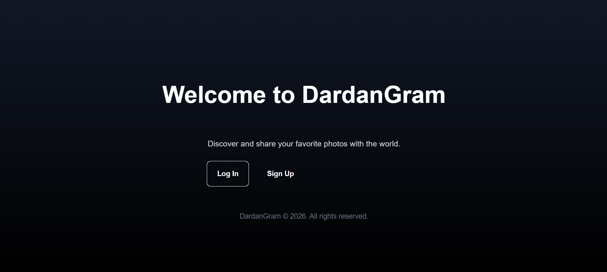
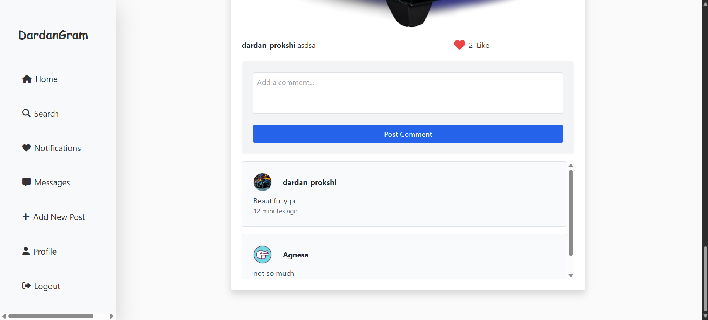
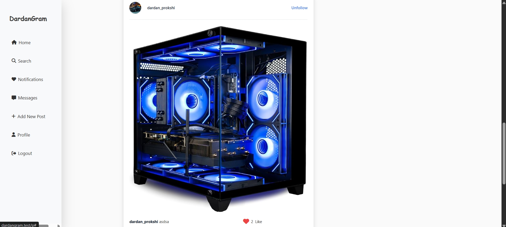
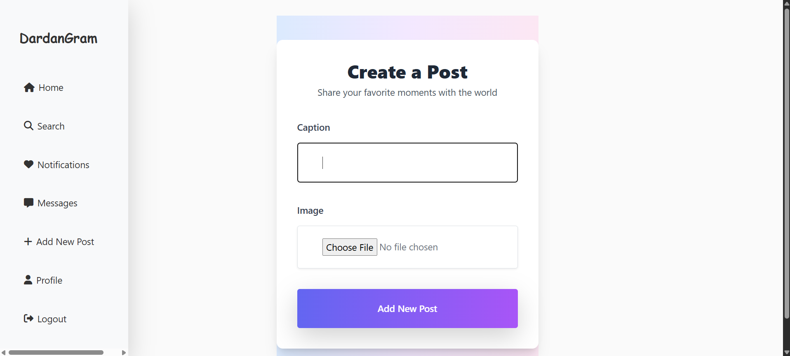
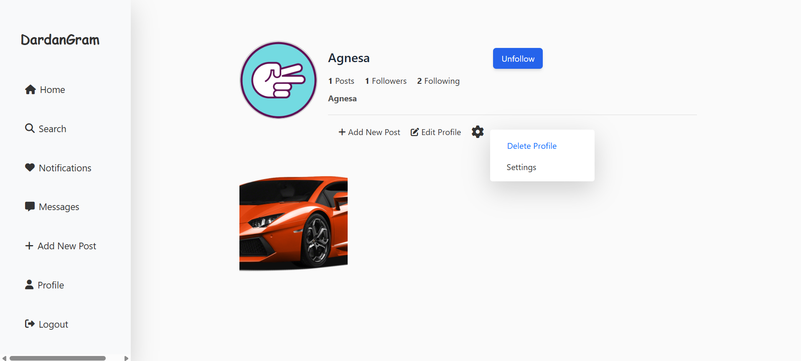
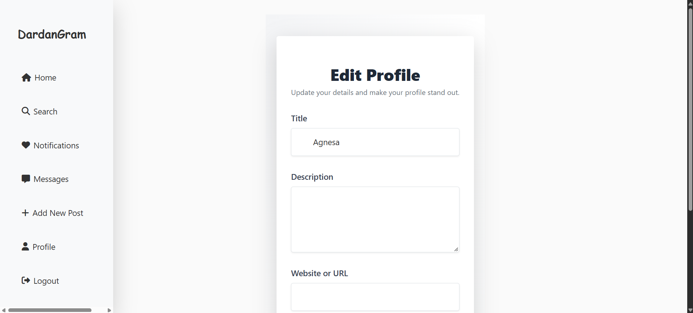
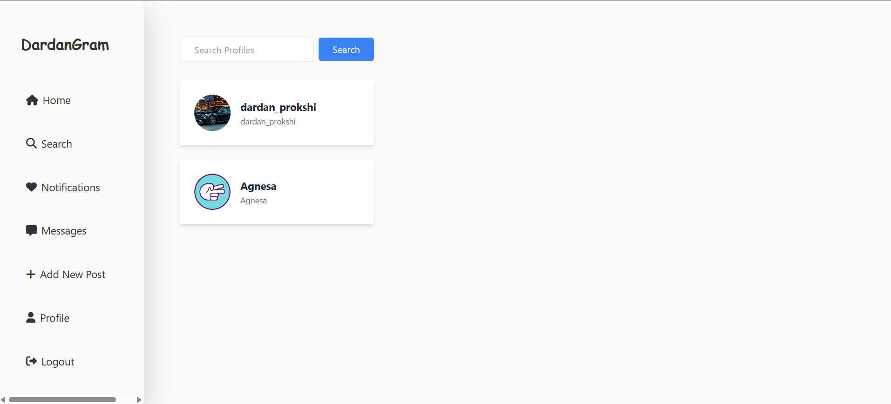
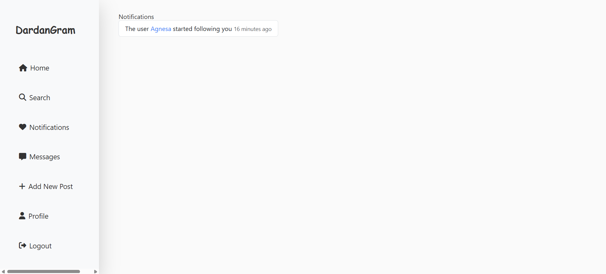

# DardanGram

**DardanGram** is a social media web application inspired by Instagram, built with Laravel. Users can create accounts, share photos, interact with posts, follow other users, and manage their profiles.

## Screenshots

### Welcome Page


### Main Feed


### Posts




### User Profiles




### Search and Notifications




## Features

- User registration and authentication
- Photo posting
- Like and comment functionality
- Follow and unfollow users
- User profiles
- Profile editing and profile pictures
- User search
- Notifications

## Technologies Used

- PHP 8.2+
- Laravel 11
- MySQL / MariaDB
- JavaScript
- Vue.js 3
- Vite
- Tailwind CSS
- Bootstrap 5
- Sass

## Installation

1. Clone the repository:

   ```bash
   git clone https://github.com/GoldKing12/DardanGram.git
   ```

2. Navigate into the project:

   ```bash
   cd DardanGram
   ```

3. Install PHP dependencies:

   ```bash
   composer install
   ```

4. Install JavaScript dependencies:

   ```bash
   npm install
   ```

5. Create your environment file:

   ```bash
   cp .env.example .env
   ```

6. Generate the application key:

   ```bash
   php artisan key:generate
   ```

7. Configure your database settings in `.env`.

8. Run migrations:

   ```bash
   php artisan migrate
   ```

9. Create the storage symbolic link:

   ```bash
   php artisan storage:link
   ```

10. Build frontend assets:

    ```bash
    npm run build
    ```

11. Start the Laravel development server:

    ```bash
    php artisan serve
    ```

Visit `http://127.0.0.1:8000` in your browser.

## Author

Dardan Prokshi

GitHub: https://github.com/GoldKing12